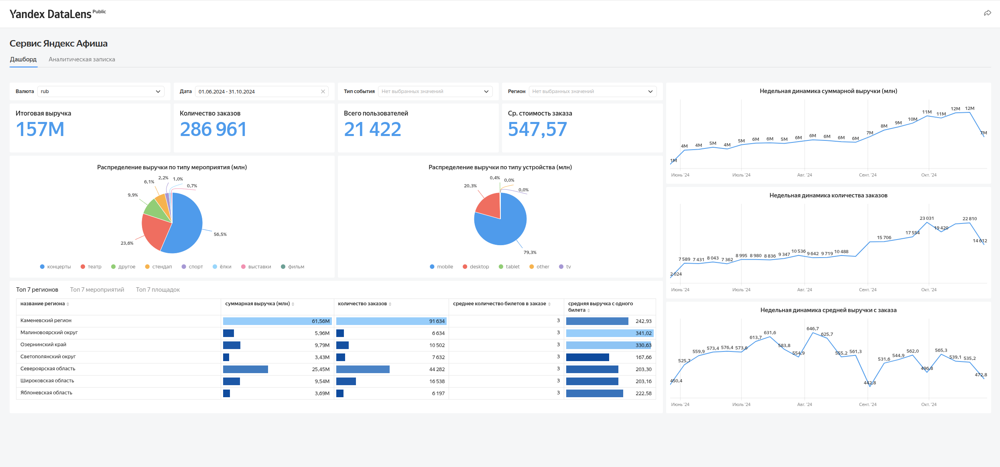

# Яндекс Афиша — комплексный анализ данных

### Дипломный проект | Яндекс Практикум

**Стек:** SQL, PostgreSQL, DBeaver, Yandex DataLens, Python, pandas, NumPy, Matplotlib, SciPy, Jupyter Notebook.

## О проекте

Цель исследования — изучить пользовательский спрос на билеты, определить сезонные закономерности, проанализировать структуру выручки и различия в поведении пользователей мобильных и десктопных устройств.

Исследование охватывает период с июня по октябрь 2024 года.

Проект состоит из трёх этапов:

1. **SQL-анализ** — расчёт основных бизнес-показателей и исследование структуры выручки.
2. **Yandex DataLens** — разработка интерактивного дашборда.
3. **Python** — исследовательский анализ данных, проверка статистических гипотез и формулирование рекомендаций.

## Интерактивный дашборд

**[Открыть дашборд в Yandex DataLens](https://datalens.yandex/a9isq09bvat2t?_share_link=public)**

На дашборде представлены:

- Ключевые показатели: выручка, заказы, пользователи, средний чек.
- Недельная динамика выручки, количества заказов и среднего чека.
- Распределение выручки по типам мероприятий и устройств.
- Топ-7 регионов, мероприятий и площадок.
- Интерактивные фильтры по валюте, периоду, типу события и региону.

### Основные показатели

| Показатель | Значение |
|---|---:|
| Общая выручка | 157 млн ₽ |
| Количество заказов | 286 961 |
| Уникальные пользователи | 21 422 |
| Средняя выручка с заказа | 547,57 ₽ |

На отображённом срезе данных:

- 79,3% выручки приходится на мобильные устройства.
- 56,5% выручки обеспечивают концерты.
- 23,6% выручки приходится на театральные мероприятия.
- Каменевский регион лидирует по выручке — 61,56 млн ₽.

## Этап 1. SQL-анализ

С помощью PostgreSQL и DBeaver подготовила SQL-запросы для расчёта и исследования:

- Общей выручки и количества заказов.
- Средней выручки на заказ.
- Количества уникальных покупателей.
- Распределения выручки по типам устройств и мероприятий.
- Недельной динамики заказов и выручки.
- Топ-7 регионов по выручке.

В запросах использовала агрегатные и оконные функции, JOIN, GROUP BY, DATE_TRUNC и CTE.

**[Посмотреть SQL-запросы](analysis_queries_final.sql)**

## Этап 2. Разработка дашборда

Разработала интерактивный дашборд в Yandex DataLens для мониторинга бизнес-показателей сервиса.

Визуализировала динамику заказов и выручки, структуру спроса, распределение выручки по устройствам и региональные показатели.

Реализовала фильтрацию и детализацию данных для исследования отдельных сегментов.

**[Открыть дашборд](https://datalens.yandex/a9isq09bvat2t?_share_link=public)**

## Этап 3. Исследовательский и статистический анализ

Объединила данные о заказах, мероприятиях и валютных курсах.

Выполнила предобработку данных:

- Проверила пропуски и дубликаты.
- Привела стоимость заказов к единой валюте.
- Исследовала аномальные значения.
- Подготовила данные к аналитическому исследованию.

После предобработки рабочий датасет содержал **287 932 строки и 31 столбец**.

Проанализировала сезонность, пользовательскую активность, структуру спроса, региональные различия и показатели билетных операторов.

Проверила статистические гипотезы о различиях в поведении мобильных и десктопных пользователей.

**[Посмотреть Jupyter Notebook](statistical_analysis_afisha.ipynb)**

## Основные результаты исследования

### 1. Сезонность спроса

Количество заказов с июня по октябрь 2024 года выросло почти втрое — приблизительно с 34 тыс. до 99 тыс. в месяц.

Дневная активная аудитория (DAU) увеличилась примерно с 560 до 1 270 пользователей.

### 2. Структура спроса

Наиболее востребованная категория — концерты, на которые приходилось около 37–43% заказов.

Осенью увеличилась доля театральных и спортивных мероприятий.

### 3. Мобильная аудитория

Около 80% заказов оформлялись с мобильных устройств.

Медианное количество заказов на пользователя:

- Мобильные устройства — 2 заказа.
- Десктопные устройства — 1 заказ.

Статистические тесты выявили значимые различия (p < 0,001).

### 4. Региональная аналитика

Каменевский регион обеспечил 27,7% заказов, Североярская область — 12,3%.

Выявила дисбалансы между спросом и предложением мероприятий в отдельных регионах.

### 5. Партнёрская сеть

Группа из 4–5 ведущих билетных операторов обеспечила около 72% выручки.

## Проверка статистических гипотез

**Гипотеза 1. Среднее количество заказов на мобильного пользователя выше, чем на десктопного.**

Тесты Уэлча и Манна — Уитни выявили статистически значимые различия (p < 0,001).

**Гипотеза 2. Среднее время между заказами у мобильных пользователей больше.**

Получены разные результаты:

- t-тест Уэлча: p = 1,0.
- Критерий Манна — Уитни: p < 0,001.

Для вывода о различии средних интервалов необходим дополнительный анализ распределений и влияния выбросов.

## Рекомендации для бизнеса

На основе результатов исследования предложила:

1. **Развивать мобильный канал** — улучшать пользовательский опыт и персонализировать предложения.
2. **Учитывать сезонность** — планировать маркетинговые кампании с учётом роста спроса осенью.
3. **Развивать семейные категории мероприятий** — учитывать изменения возрастного состава аудитории.
4. **Анализировать региональные дисбалансы** — развивать предложение мероприятий в регионах с высоким спросом.
5. **Укреплять партнёрскую сеть** — учитывать вклад крупнейших билетных операторов в выручку.
6. **Дополнительно исследовать аномалии** — проверить влияние пользователей с необычно большим количеством заказов на статистические результаты.

## Данные

Проект выполнен на учебных данных Яндекс Практикума. Названия регионов в датасете изменены в целях соблюдения конфиденциальности, поэтому они не соответствуют реальным географическим наименованиям.

Исходные датасеты не публикуются в соответствии с условиями использования учебных материалов.
Проект выполнен в рамках обучения по программе «Аналитик данных» в Яндекс Практикуме.

